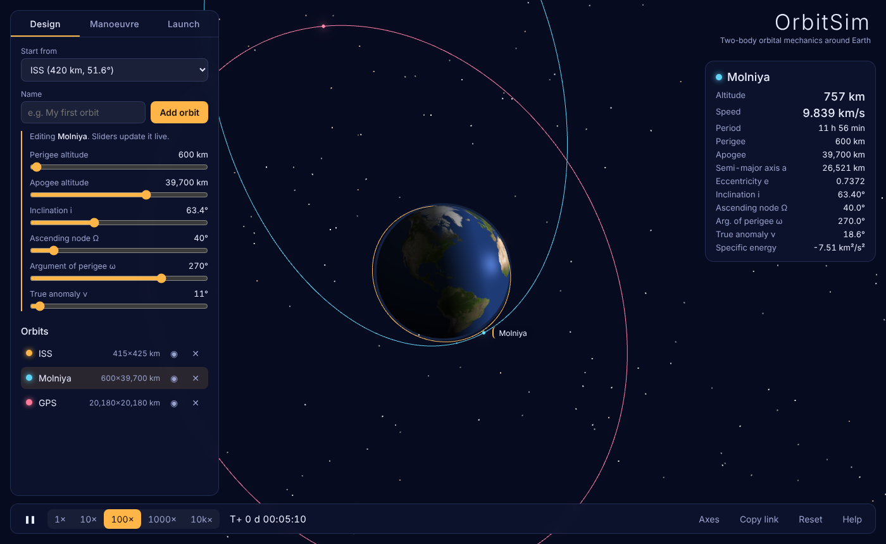
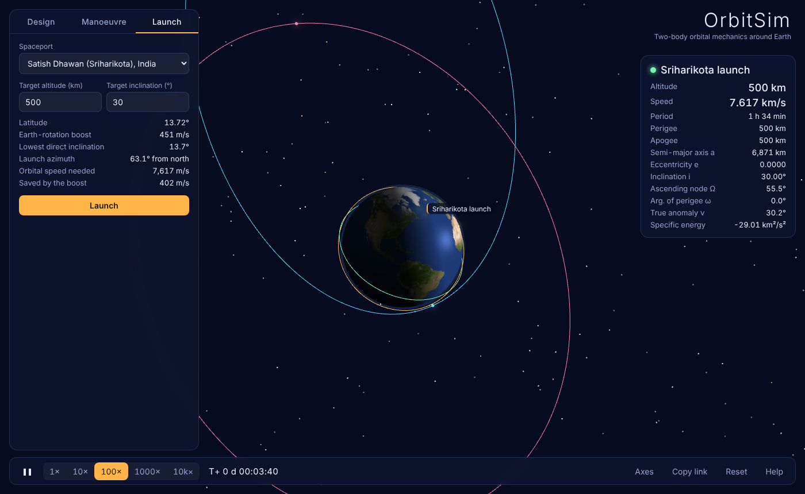

# OrbitSim

**Interactive orbital mechanics in the browser.** Design orbits from Keplerian elements, watch satellites move under real two-body physics, fire burns, plan Hohmann transfers and launch from real spaceports. No install, no build step: just a static web page.



## What you can do

| | |
|---|---|
| **Design orbits** | Start from real missions (ISS, Hubble, Sun-synchronous, GPS, Geostationary, Molniya) and adjust perigee, apogee, inclination, ascending node, argument of perigee and true anomaly with live feedback. |
| **Watch them fly** | Satellites move by solving Kepler's equation every frame, so they speed up near perigee and slow down at apogee, just like real spacecraft. Time warp from 1× to 10,000×. |
| **Fire burns** | Apply prograde, normal and radial Δv to any satellite. A dashed preview shows the resulting orbit before you commit. |
| **Plan a Hohmann transfer** | Enter a target altitude to get both burns, total Δv and transfer time. The second burn fires automatically at apogee. LEO → GEO lands within metres of 35,786 km. |
| **Launch from a spaceport** | Kennedy, Sriharikota, Kourou, Baikonur, Vandenberg. See the Earth-rotation boost, the lowest inclination you can reach directly, and the launch azimuth; the new orbit passes exactly over the launch site. |
| **Share** | "Copy link" encodes every orbit in the URL, so anyone opening it sees the same setup. |

Live telemetry for the selected satellite covers altitude, speed, period, perigee and apogee, the six orbital elements, and specific orbital energy.



## The physics

All maths lives in [`js/physics.js`](js/physics.js), separate from the rendering, and is covered by unit tests.

- **Two-body model**: Earth as a point mass, μ = 398,600.4418 km³/s², radius 6,371 km, sidereal rotation 7.292 × 10⁻⁵ rad/s.
- **Propagation**: mean anomaly advances linearly (n = √(μ/a³)); Kepler's equation *M = E − e sin E* is solved by Newton iteration and converted to true anomaly. This is exact for two-body motion, so energy and angular momentum are conserved to machine precision. A step-by-step integrator would drift.
- **Elements ⇄ state vectors**: the standard perifocal → ECI rotation R₃(−Ω) R₁(−i) R₃(−ω) and its inverse, with care for circular and equatorial edge cases.
- **Burns**: convert to position/velocity, add Δv in the local prograde/normal/radial frame, convert back.
- **Hohmann transfer**: vis-viva *v = √(μ(2/r − 1/a))* at both ends of the transfer ellipse; the second burn is scheduled at the exact apogee time, even under heavy time warp.
- **Launch sites**: rotational boost *ωR cos φ*, minimum direct inclination *|φ|*, launch azimuth *sin β = cos i / cos φ*, and an ascending node chosen so the orbit passes over the site at launch.

### Tests

```bash
npm test          # node --test, no dependencies
```

Thirteen tests check the physics against known values: the ISS period (≈ 92.8 min), the geostationary period (one sidereal day), LEO → GEO Hohmann Δv (≈ 3.9 km/s, ≈ 5.3 h), Kepler-solver accuracy up to e = 0.97, element ⇄ state round trips, conservation laws, and burn behaviour.

## Run it locally

The app uses ES modules, so serve the folder rather than opening the file directly:

```bash
python3 -m http.server 8000      # or: npx serve .
# then open http://localhost:8000
```

It works as-is on GitHub Pages too.

**Controls:** drag to orbit the camera, scroll to zoom, click a satellite to select it. Keyboard shortcuts: <kbd>Space</kbd> pauses, <kbd>1</kbd>–<kbd>5</kbd> set time warp, <kbd>A</kbd> toggles axes and the equator, <kbd>H</kbd> opens help.

## Project structure

```
index.html            UI layout
css/style.css         styling (responsive down to phone size)
js/physics.js         orbital mechanics engine (pure functions)
js/app.js             Babylon.js scene, UI wiring, simulation loop
tests/                node:test unit tests for the physics
assets/images/        Earth texture
docs/                 screenshots
```

## Built with

[Babylon.js](https://www.babylonjs.com/) for 3D rendering, plain JavaScript, HTML and CSS. No framework or bundler.

## Possible next steps

- J2 perturbation (nodal precession) to show why sun-synchronous orbits work
- Ground tracks drawn on the Earth's surface
- Real satellites from TLE data (SGP4)
